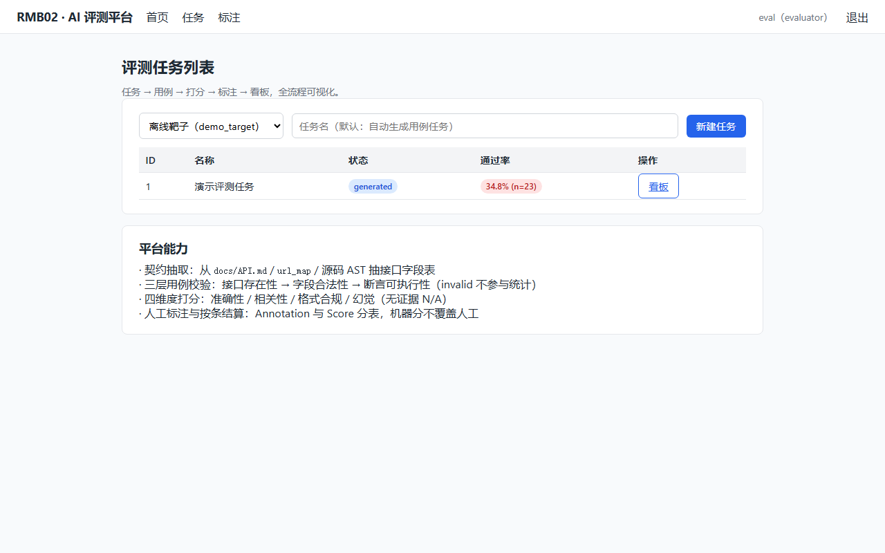
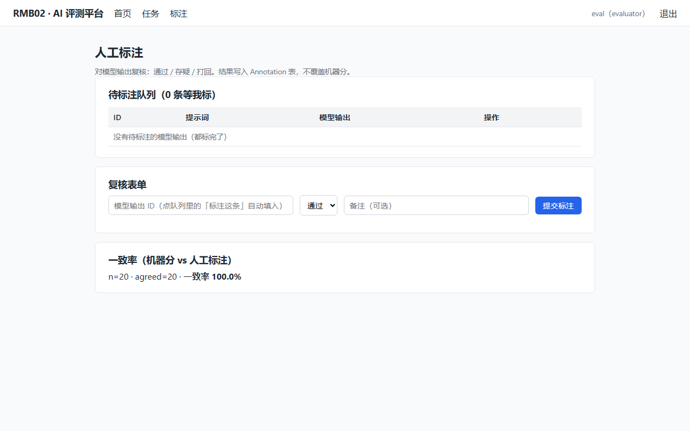
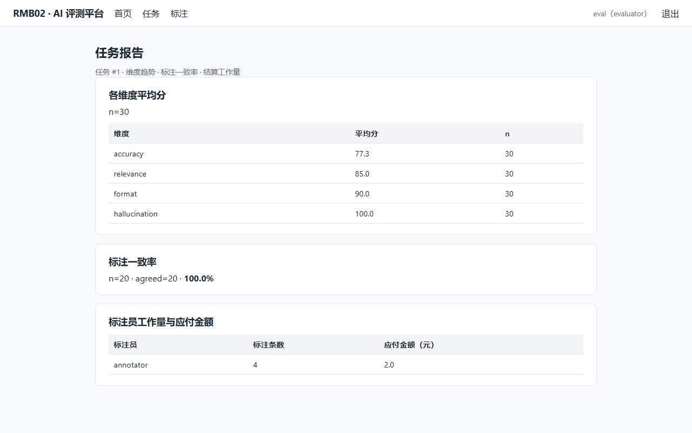
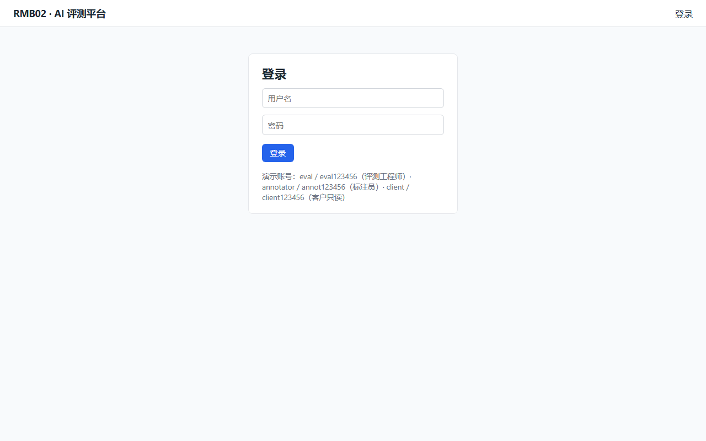

# RMB02 · AI 评测与数据服务平台

> 对 AI 产品做**端到端评测**：契约抽取 → 用例生成 → 三层校验 → 四维打分 → 人工标注 → 按条结算。
> Flask + SQLite，零前端构建步骤。

**这个项目解决什么问题**：AI 团队说不清"我的模型到底行不行"。把被测系统的接口契约抽出来，
自动生成测试用例，机器打分 + 人工复核，输出一份**带 n、带波动区间、能追到样本**的评测报告。

---

## 一、快速开始

```bash
# 1. 装依赖
python -m venv venv
venv\Scripts\activate            # Windows
pip install -r requirements.txt

# 2. 起服务（默认 5102 端口）
python app.py

# 3. 打开 http://127.0.0.1:5102
```

**演示账号**（`ensure_demo_users` 自动建）：

| 账号 | 密码 | 角色 |
|---|---|---|
| `eval` | `eval123456` | 评测工程师（建任务/生成/校验/打分/结算） |
| `annotator` | `annot123456` | 标注员（只能标注 + 看自己的） |
| `client` | `client123456` | 客户只读 |

### Docker

```bash
docker compose up -d
# 或
docker build -t rmb02 . && docker run -p 5102:5102 -v rmb02-data:/app/data rmb02
```

---

## 界面

| 任务列表 | 人工标注 |
|---|---|
|  |  |

| 评测报告 | 登录 |
|---|---|
|  |  |

> 截图来自 `demo_seed.py` 预置演示数据（评测任务 → 用例 → 打分 → 标注 → 结算全流程）。
> 报告页展示四维度平均分 + 标注一致率 + 结算金额，**每处都带 n**。

---

## 二、功能

| 模块 | 能力 |
|---|---|
| **契约抽取** | 三级来源：`docs/API.md` 字段表 → Flask `url_map` 补全 → 源码 AST 按函数作用域补充（低置信只作提示） |
| **用例生成** | 对契约每个接口生成 正常/边界/异常/authz 四类；authz 的 expected 按规则定（不是模型猜） |
| **三层校验** | 接口存在性 → 字段合法性 → 断言可执行性；invalid 标层 + 原因码，不参与统计 |
| **四维打分** | 准确性 0.4 / 相关性 0.3 / 格式 0.2 / 幻觉 0.1；**无证据幻觉 = N/A 不计总分** |
| **打分兜底** | 模型坏 JSON（代码块/中文前缀/`"85分"`/缺维度）→ `score_parse_failed`，**绝不静默当 0 分** |
| **稳定性** | n=5 条 × 3 遍 = 15 次，每条报波动区间 + 极差，`run_index` 独立 |
| **人工标注** | Annotation 与 Score **分表**，机器分不覆盖人工；一致率 n 真实 + `skipped_no_score` 上报 |
| **按条结算** | Settlement：同 (标注员, 任务) 只结算一次（幂等 + 数据库唯一约束），金额 = 条数 × 单价 |
| **看板** | 任务列表 / 通过率 / 各维度趋势 / 标注一致率 / 工作量 |
| **页面** | `/login` `/dashboard`（任务列表+新建）`/annotate`（标注+一致率）`/report/<id>`（维度+一致率+工作量） |

### 技术栈

| 层 | 选型 |
|---|---|
| Web | Flask 3.1 + Flask-SQLAlchemy 3.1（无前端构建，templates/ 直接渲染） |
| 数据库 | SQLite（单机够用；换 PostgreSQL 改 `RMB02_DATABASE_URL`） |
| 部署 | gunicorn + Docker（非 root 运行） |

---

## 三、目录结构

```
RMB02/
├── app.py              # create_app 工厂 + /healthz
├── config.py           # 模型配置四项收口（key/base_url/model/timeout）
├── models.py           # 11 张表（含 Settlement 唯一约束）
├── auth.py             # 四档角色（platform_admin/evaluator/annotator/client_viewer）
├── api.py              # 靶子/契约/用例/标注/结算/看板 REST API
├── contract_extractor.py  # 三级契约抽取（api_md/url_map/ast 函数作用域）
├── generator.py        # 用例生成（正常/边界/异常/authz，expected 规则定）
├── validator.py        # 三层校验（含 assert_unparseable/assert_empty 兜底）
├── runner.py           # 用例执行（offline test_client / HTTP）
├── scorer.py           # 四维打分 + parse_model_score 格式漂移兜底
├── stability.py        # n=5×3 稳定性实测
├── report.py           # 评测报告（单条明细 + 汇总 + Top10）
├── annotation.py       # 标注（分表）+ 一致率（n 真实）+ 结算（幂等）
├── dashboard.py        # 看板聚合
├── pages.py            # 4 个页面路由
├── demo_target/        # 离线靶子（5 接口，含鉴权+参数校验）
├── templates/          # base/login/dashboard/annotate/report
├── docs/               # API · 数据库设计 · 评测维度定义 · 运维手册 · 商业模式
└── tests/              # 165 条测试（含变异测试）
```

---

## 四、核心设计决策

### 4.1 🔴 契约抽取按函数作用域，AST 只作提示

AST 扫描定位每个 route 处理函数的 `def` 块，只扫该函数体内的 `.get('x')`。
**低置信来源两个方向都会错**（误杀 + 放宽）—— 所以 AST 字段进 `suggested_fields`
（提示），**不进允许字段集**。字段校验只认 api_md / url_map 的权威字段表。

### 4.2 🔴 打分格式漂移必须兜底，不许当 0 分

模型输出结构化分数时**必然有格式漂移**（代码块 / 中文前缀 / `"85分"` / 缺维度）。
`parse_model_score` 解析失败 → `{"ok": false, "reason": "score_parse_failed", "raw": ...}`。
**绝不静默当 0 分** —— 0 分会污染统计（一条 parse failed 会拉低整体均值，
看起来"模型答得差"其实是"分数没解析出来"）。

### 4.3 🔴 幻觉维度只对有证据来源的输出有效

无证据的开放式生成，幻觉维标 **N/A（None）**，不计入总分（三维归一）。
不许强打 0 或 100 —— 那等于对"本来就没有依据可查"的答案乱判。

### 4.4 🔴 稳定性 n 写死，波动如实报

`n=5 条 × 3 遍 = 15 次`（写死）。每条报波动区间 + 极差。
`run_index` 是独立的三次完整评测（Score 表同一 model_output_id 真有 3 条不同 run_index）。

### 4.5 🔴 Annotation 与 Score 分表

机器分和人工标注是两条线：标注只写 Annotation 表，绝不碰 Score。
（变异测试盯着：把"分表"改成"覆盖写入"必须红。）

### 4.6 🔴 结算幂等 + 数据库唯一约束

同一 (标注员, 任务) **只允许结算一次** —— 业务层先查后拒 + `uq_settle_annotator_task`
唯一约束（并发 bug 也插不进去）。**重复结算会多付一倍，这是钱的问题。**

### 4.7 🔴 一致率分母只算有机器分的标注

没机器分的标注（如 parse failed 未落 Score）无法比较，不计入分母，
但 `skipped_no_score` 必须报出来 —— 让人看见几条没算，不悄悄缩分母。

### 4.8 🔴 越权一律最小可见

标注员只能看**自己标过**的标注（API 层按角色过滤）；evaluator/platform_admin 看全部。
未登录 401，权限不足 403。

---

## 五、测试

```bash
pytest tests -q        # 165 passed
```

| 类型 | 数量 | 说明 |
|---|---|---|
| API 骨架/契约/生成 | 33 | 靶子管理、契约抽取、用例生成 |
| 三层校验（含变异） | 26 | validator + stage2 + 变异 4 个 |
| 四维打分/兜底/报告 | 29 | scorer + stage3 + report |
| 标注/结算/看板 | 45 | annotation + dashboard + agreement20 |
| demo_target | 8 | 离线靶子独立可跑 |
| authz 用例 | 4 | 公开接口提权/受保护接口 401 |

**变异测试**：validator 三层判定、scorer 权重/N/A/兜底、annotation 分表/n 虚报 ——
逐个改坏都必须红（`test_*_mutations.py`）。

---

## 六、配置

全部环境变量见 `docker-compose.yml`。关键几项：

| 变量 | 默认 | 说明 |
|---|---|---|
| `RMB02_PORT` | 5102 | 监听端口 |
| `RMB02_DATABASE_URL` | `sqlite:///./data/rmb02.db` | 换 PostgreSQL 改这里 |
| `RMB02_API_KEY` | 空 | 模型打分 key；空 → 本地规则降级 |
| `RMB02_BASE_URL` | `https://developer.amd.com.cn/radeon/api/v1` | 模型端点（四项收口） |
| `RMB02_MODEL` | `DeepSeek-V4-Flash` | 模型名 |
| `RMB02_TIMEOUT_MS` | 30000 | 模型调用超时 |

---

## 七、部署约束

### SQLite → 单 worker

`docker-compose.yml` 固定 `GUNICORN_WORKERS: "1"`。多 worker 并发写 SQLite 会
`database is locked`（结算/标注是写操作）。要横向扩展：换 PostgreSQL + `GUNICORN_WORKERS=N`。

### 已验证

| 项 | 怎么验的 |
|---|---|
| pytest 165 条 | 本地 + CI（GitHub Actions） |
| 容器真跑起来 | CI `smoke-run`：`/healthz` 200、`id -un`=appuser、容器内能写库 |
| 非 root 运行 | CI smoke-run 断言 `appuser` |
| 页面能点开 | 4 个页面 200 渲染（未登录受保护页 401） |
| 密钥不进代码 | CI grep + 本地扫 git 历史 |

### ⚠️ 未验证 / 未实现（🔴 必须如实，不许当"已做"）

| 项 | 状态 | 说明 |
|---|---|---|
| **模型打分稳定性** | ❌ 未验证 | `_model_score_for` 是**本地模拟**（`accuracy=80+run_index*2`），报出的"极差 1.6"来自模拟波动，**不是真实模型** |
| **真实模型打分** | ❌ 未验证 | 打分全程 mock，未接真模型（真实分数分布未知） |
| **用例生成的模型侧** | ❌ 未验证 | 生成的用例来自预置/规则，未用真模型生成 |
| **真实并发 / 吞吐** | ❌ 未做 | 只验了逻辑正确，没压测（无 Locust/k6） |
| **真实众包 / 支付** | ❌ 未做 | Settlement 是演示数据，没有真实打款链路 |

> 🔴 这 5 条是刻意分开的：上面是「我真跑过」，下面是「我没跑过或没做」。
> 尤其**模型打分稳定性** —— 那是模拟数字，不许写进简历当"模型输出稳定"的证据。

---

## 八、开发须知

### 加一个返回数据的接口

1. 用 `login_required('<permission>')` 装饰
2. 查数据走对应模型（标注走 Annotation 不碰 Score）
3. 同一个 PR 里补测试（权限 401/403 + 数据正确）

### 改动结算/一致率相关代码后

```bash
pytest tests -q
```

---

## 九、许可与说明

- 演示数据全部是**模拟数据**（demo_target 离线靶子），不涉及真实企业资料
- 项目用于求职展示，非生产级产品（见第七节「未验证」清单）
- 四个只读源目录（RMB01 / 刷题 / XM01 / XM03）**全程只读**，由 WorkBuddy 审查基线守护

---

*详见 [`docs/`](docs/)：API · 数据库设计 · 评测维度定义 · 运维手册 · 商业模式*
